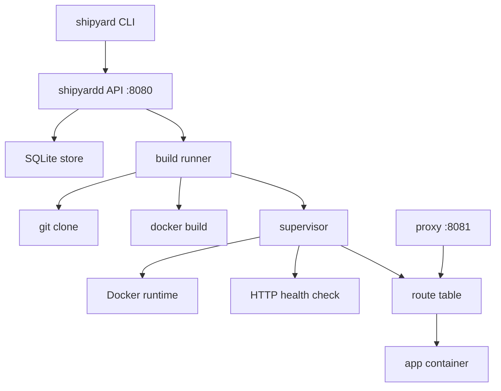
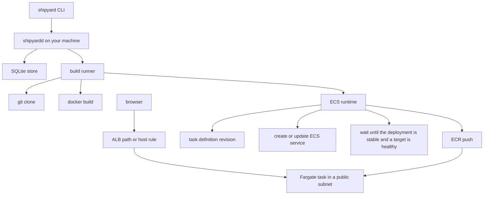

# Shipyard

Shipyard is a small platform-as-a-service. Give it a GitHub repository and it builds a container image, runs it, and routes HTTP traffic to it. The project is a learning portfolio: a Go control plane, a local runtime, then a single AWS path. It is not a general-purpose cloud.

Milestone M0 is the control plane skeleton: `shipyardd` is an HTTP API and `shipyard` is a CLI. They register applications in an in-memory store.

Milestone M1 builds a Docker image from a registered repository. It clones the repo, requires a Dockerfile at the repository root, and tags the image `shipyard/<app>:<short-sha>`.

Milestone M2 runs that image and routes traffic to it. After a build succeeds, `shipyardd` starts a container, waits until an HTTP health check passes, and only then marks the deployment `running`. A later healthy deployment takes over with a blue-green swap: traffic moves first, then the previous container stops. A reverse proxy on its own port routes `Host: <app>.localhost` and `/apps/<app>/` to the current container. The route table itself is in memory.

Milestone M3 adds the AWS path. `SHIPYARD_RUNTIME=ecs` pushes the image to ECR and runs it as a Fargate service behind the load balancer from `infra/aws`. The deploy waits until a target is healthy, and `shipyard rollback` points the service at the previous task definition. CI checks the Terraform and the Go tests. It does not apply the stack. Applying it is a manual step, written up in [docs/aws-setup.md](docs/aws-setup.md), because it needs an AWS account and it costs money. The estimate is in [docs/cost.md](docs/cost.md).

Milestone M4 is push-to-deploy and rollback, and it lands before M3. GitHub `push` events can queue a build, and `shipyard rollback` redeploys a retained image through the same health-gated swap. Both talk to the runtime only through the existing interfaces, so an ECS runtime can replace the local Docker runtime later without a second webhook or rollback implementation. Apps, deployments, and releases are stored in SQLite and survive a restart.

## Roadmap

| Milestone | What it adds |
| --- | --- |
| M0 | HTTP API, CLI, and an in-memory app and deployment store |
| M1 | Build a Docker image from a Git repository |
| M2 | Run that image locally and route traffic with a reverse proxy |
| M3 | Push the image to ECR and run it on ECS Fargate. Terraform is in `infra/aws`. Apply is manual. See [docs/aws-setup.md](docs/aws-setup.md) and [docs/cost.md](docs/cost.md). |
| M4 | Push-to-deploy from GitHub, rollback to a retained image, and a SQLite store. Works on the local Docker runtime. |
| M5 | Health checks, metrics, and operator docs. The AWS cost note is already in [docs/cost.md](docs/cost.md). |

## Out of scope

Shipyard will not grow teams, billing, Kubernetes, multi-cloud support, or custom domains. Those are real PaaS problems, and they are someone else's product.

## Quickstart

Install Go 1.22 or newer. Image builds also need `git` and `docker` on `PATH`.

```bash
make build
make run
```

`shipyardd` listens on `:8080` for the API and `:8081` for the reverse proxy. `SHIPYARD_ADDR` / `--addr` and `SHIPYARD_PROXY_ADDR` / `--proxy-addr` change those. The process needs `git` and `docker` on `PATH`, and permission to use the Docker socket.

In another shell:

```bash
./bin/shipyard apps create --name demo --repo https://github.com/golang/example --branch main
./bin/shipyard apps list
./bin/shipyard apps get demo
curl -s localhost:8080/healthz
```

Building an image requires a Dockerfile at the root of the registered repository. [`examples/hello`](examples/hello) is a tiny nginx app used by the integration test; point an app at a GitHub repository that has the same layout, then:

```bash
./bin/shipyard deploy hello --ref main
./bin/shipyard deployments list hello
./bin/shipyard logs dep_1 --follow
```

The CLI talks to `http://127.0.0.1:8080` unless you pass `--api-url` or set `SHIPYARD_API_URL`. Put `--api-url` before the command.

`apps create`, `apps update`, and `apps get` print one app as indented JSON. `apps list` prints `{"apps":[...]}`. `apps url` prints the public URL as a single line. `deploy` and `rollback` print the new deployment. `deployments list` prints `{"deployments":[...]}`. `releases` prints `{"releases":[...]}`. `logs` prints the captured build and runtime log as plain text. `stop` prints the app after its container is stopped. `created_at` is UTC. Names are stored trimmed, and repository URLs are stored in canonical form (`https://github.com/<owner>/<repo>`, without a trailing `.git`).

Apps include `branch` (default `main`), `auto_deploy` (default false), and `status`: `idle` until a deployment is healthy, `running` while traffic is routed, and `stopped` after `shipyard stop`. A running app also includes `url`. The per-app webhook secret is never returned.

### API

| Method and path | Behavior |
| --- | --- |
| `GET /healthz` | `{"status":"ok"}` |
| `POST /apps` | Register an app. Body: `{"name":"...","repo_url":"...","branch":"main","auto_deploy":false,"webhook_secret":"..."}`. `branch`, `auto_deploy`, and `webhook_secret` are optional. `201` with the app, `Location: /apps/<name>`. The secret is not in the response. |
| `PATCH /apps/{name}` | Change `branch`, `auto_deploy`, or `webhook_secret`. Omitted fields stay as they are. |
| `GET /apps` | List apps in creation order: `{"apps":[...]}`. |
| `GET /apps/{name}` | Fetch one app, including `branch`, `auto_deploy`, `status`, and, when traffic is routed, `url`. |
| `POST /webhooks/github` | GitHub webhook. See [Push-to-deploy](#push-to-deploy). |
| `POST /apps/{name}/rollback` | Redeploy a retained image. Body may be empty or `{"deployment_id":"dep_1"}`. `202` with the new deployment. |
| `GET /apps/{name}/releases` | Retained images, newest first: `{"releases":[...]}`. |
| `GET /apps/{name}/url` | `{"url":"http://<app>.localhost:8081/"}` when the app is running. `409` when it is not. |
| `POST /apps/{name}/stop` | Stop the container that is receiving traffic. `200` with the app. `409` when nothing is running. |
| `POST /apps/{name}/deployments` | Queue an image build. Body may be empty or `{"ref":"..."}`. `202` with the deployment, `Location: /deployments/<id>`. |
| `GET /apps/{name}/deployments` | List builds for one app in creation order: `{"deployments":[...]}`. |
| `GET /deployments/{id}` | Fetch one deployment. |
| `GET /deployments/{id}/logs` | Captured build log as `text/plain`. `?follow=1` keeps the stream open until the build finishes. |

`POST` routes require `Content-Type: application/json` when a body is present. `POST /apps/{name}/deployments` also accepts an empty body with no content type, which selects the repository default branch. Unknown JSON fields are rejected. Errors from these routes are JSON: `{"error":"..."}`. A path that matches no route returns net/http's plain-text 404. A known path with the wrong method returns 405 and an `Allow` header.

Validation:

- **name** is a slug of 1–63 characters. It starts with a lowercase letter and then contains lowercase letters, digits, or single hyphens. `demo-api` is valid. `Demo`, `1demo`, `demo--api`, and `demo-` are not. Surrounding whitespace is trimmed before this check.
- **repo_url** must be `https://github.com/<owner>/<repo>` (a trailing `.git` or slash is accepted and removed). The host must be `github.com`. Query strings, fragments, ports, userinfo, and other hosts are rejected. Owner and repository keep their original case.
- **ref** is optional. Empty means the default branch. Otherwise it is a branch, tag, or commit SHA of at most 255 characters, using letters, digits, `.`, `_`, `-`, and `/`. It cannot start with `-`, contain `..` or `//`, or end with `/`, `.`, or `.lock`.
- **deployment id** in URLs must look like `dep_1`.

Duplicate names return `409`. A valid name that is not registered returns `404`. A full build queue returns `503`.

Deployment records contain `id`, `app_name`, `ref`, `commit_sha`, `status`, `image_tag`, `url`, `error`, `created_at`, and, once a worker starts, `started_at` and `finished_at`. Status moves through `queued`, `building`, `starting`, and `running`. A build with no runtime still ends at `succeeded`. `failed` means the build or the health gate stopped. `stopped` means a running container was replaced or stopped with `shipyard stop`. `url` is set when the deployment becomes the one receiving traffic. The image tag is `shipyard/<app>:<12 hex chars of the commit>`.

`shipyardd` stores apps, deployments, logs, webhook delivery ids, and releases in SQLite (`shipyard.db`, or `--db` / `SHIPYARD_DB`). `SHIPYARD_DB=memory` keeps the in-memory store used by tests. The distroless image sets `SHIPYARD_DB=memory` because that filesystem is not a place to keep a database. A restart keeps the records. In local mode it does not keep the route table or the containers: startup removes containers labeled `shipyard.managed=true`, marks a deployment that was `running` as `stopped`, and marks `queued`, `building`, or `starting` deployments `failed` with `interrupted by restart`. Roll back or deploy again to serve traffic. In ECS mode the Fargate task keeps running. Startup only fails the in-progress builds, and `shipyard stop` can still scale the service to zero. The webhook secret is stored for signature checks and is never written to the log.

The M0 store helper `CreateDeployment` can still record a `pending` placeholder. The build pipeline does not use that status.

### Builds

`POST /apps/{name}/deployments` stores a `queued` deployment and returns immediately. A fixed pool of workers (default 2) pulls jobs from a bounded queue (default 16). A worker:

1. Marks the deployment `building`.
2. Shallow-clones the app's GitHub URL at the requested ref into a temp directory. An empty ref fetches the remote `HEAD`.
3. Requires a regular `Dockerfile` at the repository root. A missing file fails the deployment with `no Dockerfile at repository root`.
4. Runs `docker build` and tags `shipyard/<app>:<short-sha>`.
5. Marks the deployment `starting` and deletes the temp directory. Without a runtime configured, it marks `succeeded` here and stops.
6. Starts the image, polls the health path, and marks the deployment `running` only after a 2xx response. A timeout or a start error marks it `failed` and removes the new container.
7. Points the proxy at the new container, then stops the previous one and marks that deployment `stopped`.

The build timeout (default 10m) covers the clone and `docker build`. The clone uses a shorter timeout (default 2m) inside that budget. The health gate has its own timeout (default 30s) after the image exists. Canceling the server context, or stopping the process, cancels queued and in-flight builds. Output is appended to an in-memory log of at most 1 MiB. `GET /deployments/{id}/logs` returns what has been captured. With `?follow=1` it flushes new chunks until the status is `succeeded`, `running`, `failed`, or `stopped`. `shipyard logs --follow` uses that mode and exits 1 unless the deployment `succeeded` or is `running`.

`shipyardd` settings, overridable by flag or environment:

| Setting | Flag | Environment | Default |
| --- | --- | --- | --- |
| Listen address | `--addr` | `SHIPYARD_ADDR` | `:8080` |
| Workers | `--build-concurrency` | `SHIPYARD_BUILD_CONCURRENCY` | `2` (1–32) |
| Queue length | `--build-queue-size` | `SHIPYARD_BUILD_QUEUE_SIZE` | `16` (1–256) |
| Build timeout | `--build-timeout` | `SHIPYARD_BUILD_TIMEOUT` | `10m` (1s–30m) |
| Clone timeout | `--clone-timeout` | `SHIPYARD_CLONE_TIMEOUT` | `2m`, and not longer than the build timeout |
| Clone size cap | `--clone-max-bytes` | `SHIPYARD_CLONE_MAX_BYTES` | `104857600` (100 MiB, including `.git`) |
| Proxy address | `--proxy-addr` | `SHIPYARD_PROXY_ADDR` | `:8081` |
| Container port | `--container-port` | `SHIPYARD_CONTAINER_PORT` | `8080`. The container receives `PORT` set to this value. |
| Memory limit | `--memory-bytes` | `SHIPYARD_MEMORY_BYTES` | `268435456` (256 MiB) |
| CPU limit | `--cpus` | `SHIPYARD_CPUS` | `0.5` (half a core) |
| Health path | `--health-path` | `SHIPYARD_HEALTH_PATH` | `/` |
| Health timeout | `--health-timeout` | `SHIPYARD_HEALTH_TIMEOUT` | `30s` |
| Health interval | `--health-interval` | `SHIPYARD_HEALTH_INTERVAL` | `500ms` |
| Docker network | `--runtime-network` | `SHIPYARD_RUNTIME_NETWORK` | empty. Empty publishes `127.0.0.1:<random>`. A name attaches the container to that network and does not publish a host port. |
| Database | `--db` | `SHIPYARD_DB` | `shipyard.db`. `memory` uses the in-memory store. |
| Release history | `--release-history` | `SHIPYARD_RELEASE_HISTORY` | `5` (1–50). Successful images kept per app. |
| Webhook secret |  | `SHIPYARD_GITHUB_WEBHOOK_SECRET` | empty. Global HMAC secret. A per-app `webhook_secret` wins for that app. The value is not logged and is not a flag, so it does not appear in the process arguments. |
| Runtime | `--runtime` | `SHIPYARD_RUNTIME` | `docker`. `ecs` pushes to ECR and runs on Fargate. The AWS settings are in [docs/aws-setup.md](docs/aws-setup.md). |

### Architecture

`SHIPYARD_RUNTIME` selects the diagram. The default is local Docker.

Local mode:



AWS mode (`SHIPYARD_RUNTIME=ecs`). `shipyardd` still runs on your machine. Browsers use the load balancer, not the local proxy.



Clone, image build, and the container runtime sit behind interfaces so tests can replace them:

- `source.Cloner` (`internal/source`). `Git` shells out to `git`. `Fake` writes a fixture tree.
- `build.Builder` (`internal/build`). `Docker` shells out to `docker build`. `Fake` records the tag and returns a scripted result.
- `runtime.Runtime` (`internal/runtime`). `Docker` shells out to `docker run`, `docker rm`, `docker inspect`, and `docker logs`. `ecs.Runtime` (`internal/runtime/ecs`) uses aws-sdk-go-v2 behind small interfaces: push to ECR, register a task definition, create or update the service, and wait until the target group is healthy. A deploy of an image that already has a task definition points the service at that revision. `Fake` records start and stop calls. `HTTPChecker` polls the health path for local containers. `PassChecker` is used for ECS because that wait already happened inside `Start`. `FakeChecker` returns a scripted result.
- `deploy.Runner` (`internal/deploy`) owns the queue, timeouts, status transitions, temp directories, and log capture. With a releaser configured, it hands a built image to the supervisor.

The Docker builder and the local runtime call the `docker` CLI instead of the Docker Engine SDK. Current Docker installs build with BuildKit, and `docker build` is that builder. The Engine SDK `ImageBuild` call is the legacy builder; driving BuildKit through the SDK needs a session client and a much larger module graph. The CLI is the same command a person would run. The context directory, tag, container name, limits, and image are exec arguments. The ECS runtime is the exception: it calls AWS through aws-sdk-go-v2. The SQLite store uses `modernc.org/sqlite`. ECR login passes the password on stdin, not as a command argument.

`git` and `docker` run as subprocesses, never through a shell. On Unix each child is its own process group and is killed when the context ends, so a timed-out fetch does not leave `git-remote-https` behind. The git environment drops inherited `GIT_*` variables and disables credential prompts. `docker run -d` returns as soon as the daemon has created the container; the container itself keeps running until Shipyard stops it.

### Running a container

The container name is `shipyard-<app>-<deployment id>`. `docker run` sets a memory limit, a CPU limit, `--pids-limit`, `--cap-drop ALL`, and `--security-opt no-new-privileges`. It passes `PORT` to the process. If the image config already names a non-root user, that user is kept. Otherwise the container runs as uid 65534. Images that can only start as root fail the health gate and are removed.

With no runtime network, Docker publishes `127.0.0.1:<random>` to the container port and the proxy dials that address. `make run` uses this mode. With `--runtime-network` (or `SHIPYARD_RUNTIME_NETWORK`), the container joins that network and is not published on the host. The proxy dials `http://<container-name>:<port>`, which works when `shipyardd` is on the same network. `docker compose up` uses the `shipyard` network.

The health check is a GET of the configured path. Redirects are not followed. A 2xx response is healthy. Anything else is retried until the health timeout. Only a healthy container is marked `running` and inserted into the route table. The previous container keeps serving until that insert, then it is stopped.

The proxy is a `net/http/httputil` reverse proxy. It chooses the app from the `Host` header `<app>.localhost` (the port is ignored) and otherwise from `/apps/<app>/`, which is stripped before the request is forwarded. An unknown request is 404. A known app with nothing routed is 503 `app <name> is not running`. A selected upstream that does not answer is 502. Each proxy request is logged with `app`, `status`, and `latency_ms`.

### Security limits

- Repository URLs are re-checked at clone time and must still be `https://github.com/<owner>/<repo>`.
- Refs are a single git argument from a small character set, so they cannot be parsed as options (`--upload-pack=...`) or refspecs.
- Checkout size and clone time are capped. The temp directory is removed on success, failure, and panic.
- A symlink that points outside the checkout fails the build before `docker build` runs. The Dockerfile itself must be a regular file.
- The image tag passed to docker is only `shipyard/<slug>:<hex>`.
- Container names, published ports, network names, and `docker rm` targets are checked before they are passed as arguments. `docker run` uses `--pull never`, so it does not fetch an image from a registry.

The distroless `shipyardd` image below is only the API process. It does not contain `git` or `docker`, so it cannot build or run apps. Builds and the local runtime need `shipyardd` on a machine where those binaries are installed (`make run`) or the compose image in `Dockerfile.local`.

### 60-second demo

`examples/hello` is an nginx image that listens on 8080 as a non-root user and serves `hello from shipyard`. Put that Dockerfile and `index.html` at the root of a GitHub repository. With Docker already running:

```bash
make build
make run
```

In a second terminal, before the minute is up:

```bash
./bin/shipyard apps create --name hello --repo https://github.com/<owner>/<repo>
./bin/shipyard deploy hello --ref main
./bin/shipyard logs dep_1 --follow
curl -fsS http://127.0.0.1:8081/apps/hello/
./bin/shipyard apps url hello
curl -fsS -H 'Host: hello.localhost' http://127.0.0.1:8081/
./bin/shipyard stop hello
```

`logs --follow` exits when the deployment is `running`. The path URL works without DNS for `*.localhost`. The host URL works where the resolver answers `*.localhost` with `127.0.0.1`. `make test-integration` runs this same hello image through the proxy without a GitHub round trip. The page includes `version`, taken from the image `VERSION` build arg, so a rollback is visible in the body.

## Push-to-deploy

`POST /webhooks/github` accepts GitHub webhook deliveries.

1. Read the raw body. The signature is the HMAC-SHA256 of those exact bytes.
2. Compare `X-Hub-Signature-256` (`sha256=` plus hex) with the app secret, or with `SHIPYARD_GITHUB_WEBHOOK_SECRET` when the app has none. The compare is constant time. A missing or wrong signature is `401`. The secret is never logged.
3. `X-GitHub-Event: ping` is `200` `{"status":"pong"}`. Any other event except `push` is `202` `{"status":"ignored"}`.
4. A `push` is deployed only when the app's `auto_deploy` is true and `ref` is `refs/heads/<branch>` for that app's `branch` (default `main`). Anything else, including a deleted branch, is `202` ignored.
5. `X-GitHub-Delivery` is stored. The same id is `202` `{"status":"duplicate"}` and does not start another build.
6. If that app already has a build waiting in the queue, the queued deployment is updated to the newest commit instead of enqueueing another one. A build that has already started is left alone. The next push queues one new build.

Create the app with auto-deploy on, and give GitHub either the global secret or the per-app secret:

```bash
export SHIPYARD_GITHUB_WEBHOOK_SECRET='choose-a-long-secret'
./bin/shipyard apps create --name hello --repo https://github.com/<owner>/<repo> --branch main --auto-deploy
```

In the GitHub repository, add a webhook: payload URL `https://<public-host>/webhooks/github`, content type `application/json`, secret equal to `SHIPYARD_GITHUB_WEBHOOK_SECRET`, events **Just the push event**. The per-app secret is `apps create --webhook-secret` or `apps update NAME --webhook-secret`. An app that has its own secret does not accept the global one.

`shipyardd` listens on localhost. To show a delivery from GitHub, expose port 8080 with either tool, then put that HTTPS URL in the webhook:

- [ngrok](https://ngrok.com/): `ngrok http 8080`, and use `https://<subdomain>.ngrok.io/webhooks/github`.
- [smee.io](https://smee.io/): create a channel, set that URL as the GitHub payload URL, and run `smee --url https://smee.io/<channel> --target http://127.0.0.1:8080/webhooks/github`.

Both are optional. A `curl` with a correctly signed body hits the same endpoint.

## Rollback

A deployment that reaches `running` (or `succeeded`, when no runtime is configured) is a release. Shipyard keeps the last `--release-history` images per app, default 5. Older images are dropped. On the local runtime the dropped tag is removed with `docker rmi` when nothing retained still uses it. On ECS the matching ECR tag is deleted. The repository lifecycle policy also keeps the last 5 images.

`shipyard rollback` does not clone or build. It starts the retained image and waits for the same health gate. Traffic moves only after that check passes. If the new container fails the health check, the previous container keeps serving.

```bash
./bin/shipyard releases hello
./bin/shipyard rollback hello
./bin/shipyard rollback hello --to dep_1
curl -fsS http://127.0.0.1:8081/apps/hello/
```

With no `--to`, rollback redeploys the release before the one that is running. When nothing is running, it redeploys the newest retained image. `--to` must be one of the retained deployment ids.

### ROLLBACK demo

`examples/hello` bakes a `VERSION` build arg into the page (the Dockerfile default is `dev`). A normal deploy does not pass build args, so two commits need to contain two different pages, or two different `ARG VERSION` defaults. After the first is serving, deploy the second, then roll back. The proxy returns the first page again, and the second container is stopped only once the first image is healthy.

```bash
make build
make run
```

```bash
./bin/shipyard apps create --name hello --repo https://github.com/<owner>/<repo> --branch main
./bin/shipyard deploy hello --ref <commit-v1>
./bin/shipyard logs dep_1 --follow
curl -fsS http://127.0.0.1:8081/apps/hello/
./bin/shipyard deploy hello --ref <commit-v2>
./bin/shipyard logs dep_2 --follow
curl -fsS http://127.0.0.1:8081/apps/hello/
./bin/shipyard releases hello
./bin/shipyard rollback hello --to dep_1
./bin/shipyard logs dep_3 --follow
curl -fsS http://127.0.0.1:8081/apps/hello/
```

The integration test does this without GitHub: it builds the hello image twice with `VERSION=v1` and `VERSION=v2`, serves v2, rolls back to the v1 image, and checks that the proxy body contains `version v1`.

To run `shipyardd` itself in a container with the Docker socket:

```bash
docker compose up --build
```

The first image build is longer than the walkthrough above. After the API answers on port 8080, the same CLI commands apply. Compose sets `SHIPYARD_RUNTIME_NETWORK=shipyard`, so app containers are reached on that network instead of a published host port.

### Docker

The published `shipyardd` image is a multi-stage build. The runtime stage is `gcr.io/distroless/static-debian12:nonroot`, so the process runs as the distroless `nonroot` user and listens on port 8080. It does not run application containers.

```bash
docker build -t shipyardd:dev .
docker run --rm -p 8080:8080 shipyardd:dev
```

`Dockerfile.local` is the compose image. It adds `git` and `docker-cli` and expects `/var/run/docker.sock` to be mounted.

### Tests and lint

```bash
make test
make lint
make test-integration   # needs Docker; builds, runs, and proxies examples/hello
```

`make test` runs `go test -race` with an atomic coverage profile. The Docker integration test stays skipped unless `SHIPYARD_INTEGRATION=1`. `make lint` runs `go vet` and golangci-lint v1.61.0. Install that version so local lint matches CI:

```bash
curl -sSfL https://raw.githubusercontent.com/golangci/golangci-lint/v1.61.0/install.sh | sh -s -- -b "$(go env GOPATH)/bin" v1.61.0
```

GitHub Actions runs vet, golangci-lint, `go test -race` with coverage, the integration test against [`examples/hello`](examples/hello), `docker build` of the distroless `shipyardd` image, and a Terraform job. The Terraform job runs `fmt -check`, `init -backend=false`, `validate`, and `tflint`. It has no AWS credentials and does not apply. The integration test builds `examples/hello` twice with `VERSION=v1` and `VERSION=v2`, serves v2, rolls back to the v1 image, checks that the proxy body contains `version v1`, and removes the containers and images.

## Layout

- `cmd/shipyardd` — HTTP API, build workers, container supervisor, and reverse proxy
- `cmd/shipyard` — CLI (`apps`, `deploy`, `deployments list`, `releases`, `rollback`, `logs`, `stop`)
- `internal/api` — routing, handlers, and input validation (`net/http`, `log/slog`)
- `internal/deploy` — build queue, status transitions, timeouts, and log capture
- `internal/source` — `Cloner` interface, `git` implementation, and test fake
- `internal/build` — `Builder` interface, `docker build` implementation, and test fake
- `internal/runtime` — `Runtime` and health-check interfaces, Docker implementation, fakes, and the blue-green supervisor
- `internal/runtime/ecs` — ECS Fargate runtime. AWS calls sit behind interfaces and the tests use fakes
- `infra/aws` — Terraform for the VPC, ECR, ECS, IAM, logs, and the load balancer. `make aws-up` / `make aws-down`
- `docs/aws-setup.md` — account, MFA, IAM, budget, apply, deploy, and teardown
- `docs/cost.md` — monthly cost estimate. The load balancer is the main cost
- `internal/proxy` — reverse proxy and public URL
- `internal/route` — in-memory table of the container currently serving each app
- `internal/store` — `Store` interface, the in-memory store, SQLite, and migrations
- `internal/webhook` — GitHub HMAC verification and push parsing
- `internal/config` — listen addresses, API URL, build limits, and runtime limits
- `examples/hello` — static nginx app built, run, and proxied by the integration test
- `docker-compose.yml` — `shipyardd` with the Docker socket and the `shipyard` network

## License

MIT. See [LICENSE](LICENSE).
